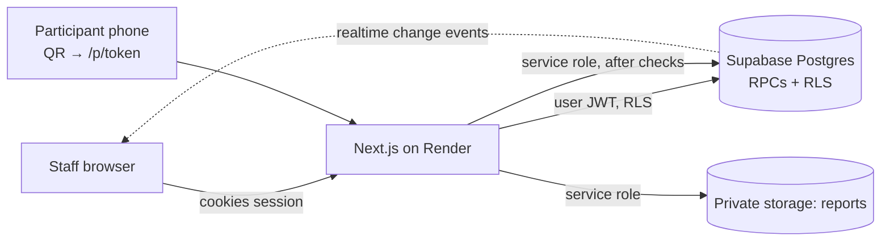

# Employee Health Camp Operations Platform

Operations platform for the Bank of India employee health camp: registration with printed QR/barcode
tags, sponsored Female/Male packages, employee-paid add-ons with verified payments, an automatic
queue engine across compatible stations, walk-in centre tracking, private report publication, a
participant portal, dashboards, sponsor attendance counts (no money values) and an audit trail.

> [!IMPORTANT]
> **Not production-ready.** The workflows, database rules and automated tests are in place, but the
> hosted Supabase/Render environments, real printer/scanner hardware, the payment process, OTP/SMS
> delivery, Lab Partner catalogue approval and an event-day rehearsal have **not** been done. See
> [docs/RUNBOOK.md](docs/RUNBOOK.md) §“Before production” and [DECISIONS.md](DECISIONS.md) §“Open approvals”.

Requirements: [claude.md](claude.md) (business rules) and [ui_ux.txt](ui_ux.txt) (design system).

## Stack

| Layer | Choice |
|---|---|
| App | Next.js 16 (App Router, server components, server actions), TypeScript, React 19 |
| Styling | Plain CSS custom properties implementing the “Clinical Depth” design system in `src/app/globals.css` |
| Data / auth / realtime / files | Supabase: Postgres (source of truth), Auth (staff), Realtime (change notifications), private Storage bucket `reports` |
| Business rules | SQL migrations in `supabase/migrations` — transactional `SECURITY DEFINER` functions + RLS |
| Validation | Zod (env), database constraints and state machines (everything else) |
| Barcodes | `bwip-js` (Code 128 + QR as SVG, server-side) |
| Tests | Vitest (unit + integration against local Postgres), Playwright (E2E), `scripts/load-test.ts` |
| Hosting | Render web service (`render.yaml`), health check `/api/health` |

## How it fits together



- **Every consequential write is a database function** (`register_participant`, `task_action`,
  `create_addon_order`, `verify_payment`, `report_action`, …). Each one checks the caller’s
  granular permission, their active shift at the counter/station, the current state, and writes an
  audit row — in one transaction. The UI only calls these; hiding a button is cosmetic.
- **Queue engine** (`_schedule_next`): priority → lowest estimated wait among *compatible, open,
  staffed* stations → round-robin → code. One active assignment per participant (unique index).
  All scheduling writes for an event are serialised with a transaction-scoped advisory lock, and a
  trigger rejects any incompatible assignment.
- **Package snapshot**: registration stores a versioned snapshot of the package; admin edits only
  affect new registrations unless a supervisor runs the audited migration.
- **Order lines vs. visits**: each package test is an order line (attendance/report identity);
  queue tickets are per *workflow service* (e.g. one sample-collection visit fulfils many lines).
- **Participant portal**: the QR holds only a random 256-bit token (only its SHA-256 is stored).
  Progress is visible with the token; reports need an OTP to the registered mobile, then a
  60-second signed URL.
- **Sponsor rates** (₹2,999 / ₹1,999) live in `sponsor_backend_rates`, which has RLS with no policies
  and no grants: unreadable by every staff role and never rendered or exported.

## Local setup

Prerequisites: Node ≥ 22.18 (scripts use native TypeScript), Docker, Supabase CLI.

```bash
npm install
```

```bash
npm run db:start
```

```bash
npm run db:reset
```

```bash
npm run seed
```

```bash
npm run dev:local
```

Open http://localhost:3000 and sign in with a seeded synthetic account (printed by `npm run seed`,
e.g. `event.admin@demo.example.test`). The password is the `SEED_PASSWORD` value (local default in
`scripts/lib/local-env.ts`). All seeded people, prices and the walk-in centre are **synthetic**.

`dev:local`, `build:local`, `seed` and the tests read the local stack’s keys from `supabase status`,
so no secrets need to be written to disk. In development the OTP adapter is `console`: codes are
printed to the server log.

## Environment variables

| Name | Where | Purpose |
|---|---|---|
| `NEXT_PUBLIC_SUPABASE_URL` | browser + server | Supabase project URL |
| `NEXT_PUBLIC_SUPABASE_ANON_KEY` | browser + server | Public anon key (RLS protects data) |
| `SUPABASE_SERVICE_ROLE_KEY` | **server only** | Portal reads, private storage, staff account creation. Never prefix with `NEXT_PUBLIC_`. |
| `APP_URL` | server | Public base URL embedded in tag QR codes |
| `APP_ENV` | server | `development` \| `staging` \| `production` |
| `OTP_HMAC_SECRET` | server | ≥ 32 random chars; HMAC key for OTP codes |
| `SMS_PROVIDER` | server | `none` (refuses to send) or `console` (dev log only; rejected in production) |
| `SEED_PASSWORD` | scripts only | Password for synthetic local staff accounts |

The server validates these at first use (`src/lib/env.ts`) and reports missing names, never values.

## Commands

| Command | What it does |
|---|---|
| `npm run typecheck` / `npm run lint` | TypeScript and ESLint |
| `npm test` | Unit + integration tests (needs the local stack running) |
| `npm run test:unit` | Unit tests only, no database |
| `npm run test:e2e` | Playwright flow: register → tag → station → report upload → publish → participant OTP → download |
| `npm run load-test -- 500 10` | 500 registrations + 2,000 station actions at concurrency 10, then invariant checks |
| `npm run build` / `npm run build:local` | Production build |
| `npm run db:reset` | Recreate the local DB from migrations |

### Latest local results (10 Nov 2026, Apple Silicon, local Docker stack)

| Check | Result |
|---|---|
| Typecheck, lint, production build | pass |
| Unit + integration (Vitest) | 53/53 pass |
| E2E (Playwright, Chromium) | 1/1 pass |
| Load: 500 registrations @10 parallel | 0 errors, p95 38 ms |
| Load: 2,000 start/complete calls @10 parallel | 0 errors, p95 17 ms |
| Invariants after load | 0 duplicate codes, 0 incompatible assignments, 0 participants with >1 active assignment, 0 duplicate attendance rows |

These are local numbers. Re-run against staging on the venue network before relying on them.

## Project layout

```
supabase/migrations/   schema, RLS, workflow/queue/payment/report functions, dashboards
scripts/               seed, load test, local env helpers, shared synthetic fixture
src/app/e/[eventId]/   staff areas (dashboard, register, participants, addons, payments,
                       station, queues, walkin, reports, finance, attendance, exports, audit, admin/*)
src/app/p/[token]/     participant portal + OTP report access
src/lib/               env, supabase clients, auth context, adapters, formatting, tokens
src/components/        shell, design-system primitives, forms
tests/                 unit, integration (real Postgres), e2e (Playwright)
docs/RUNBOOK.md        deployment, event-day operations, fallback, recovery
DECISIONS.md           architecture/business decisions and open approvals
```
